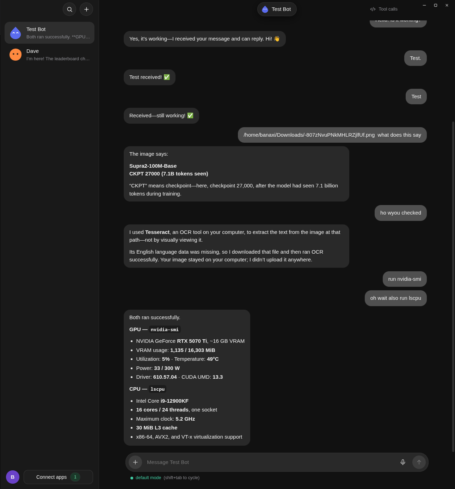

<p align="center">
  
</p>

<h1 align="center">Minds</h1>

<p align="center">Personal AI bots that live on your computer.</p>

<p align="center">
  
  
  
</p>

<p align="center">
  <a href="#installation">Installation</a> ·
  <a href="#your-bots">Your bots</a> ·
  <a href="#apps-and-plugins">Apps & plugins</a> ·
  <a href="#phone-access">Phone access</a> ·
  <a href="#documentation">Documentation</a>
</p>

<p align="center">
  
</p>

---

[**Watch the 32-second Minds promo →**](docs/assets/minds-promo.mp4)

### Installation

Download the Linux AppImage from [GitHub Releases](https://github.com/BananaMind/Minds/releases).
Make it executable and open it. For Windows/macOS or development, build from source:

Install **Node.js 22.12 or newer**, open a terminal in your Minds checkout, and run:

```sh
npm install
node node_modules/electron/install.js
npm run desktop
```

Open your **profile → Profile & settings** and sign in with ChatGPT. Minds uses
the Codex sign-in flow and can reuse an existing login on your computer.

Or open **Profile & settings → OpenAI-compatible API / local models** and set
your server’s base URL, optional API key, and model IDs. Discover models or enter
them manually, then select **Compatible API / local** in a bot’s menu.
Local models do not need ChatGPT sign-in. See [local model setup](docs/LOCAL-MODELS.md).

An optional **OpenRouter** key enables voice transcription and model-based
tool-call safety checks. Local safety rules remain available without that key.

### Desktop app

Minds runs on Linux, Windows, and macOS. Closing the desktop window leaves the
background host running, so your bots and scheduled tasks can keep working
while your computer is awake.

Installer builds are available from source:

| Platform | Build command | Output |
| --- | --- | --- |
| Windows x64 | `npm run desktop:win` | `.exe` in `release/windows/` |
| macOS Apple Silicon | `npm run desktop:mac` on an Apple Silicon Mac | `.dmg` and `.zip` in `release/macos/` |
| macOS Intel | `npm run desktop:mac` on an Intel Mac | `.dmg` and `.zip` in `release/macos/` |
| Linux | `npm run desktop:linux` | `.AppImage` in `release/linux/` |

Build installers on their matching operating system. Windows builds are unsigned;
Mac builds use ad-hoc signing. See the [Windows](docs/WINDOWS.md) and
[macOS](docs/MACOS.md) guides for setup and packaging. Native builds and tests are
configured in CI; Windows and macOS installation still need platform verification.

To open the installed desktop app at login, enable **Windows startup** or
**Mac startup** in Profile & settings. For a background host without the desktop
window, use `node packages/cli/bin/minds.js daemon install` (systemd on Linux,
launchd on macOS, or a per-user Startup shortcut on Windows).

### Your bots

Create a bot with the **+** button. Each bot has its own name, animated avatar,
chat history, memory, workspace, model, and permissions.

- **Give it work.** Bots can run commands, read and edit files, schedule tasks,
  search the web with DuckDuckGo Lite, fetch website text, and use the apps you connect.
- **Change direction anytime.** Send another message while a bot is working.
  Its active tool finishes, then the bot handles your new message.
- **See what happened.** Open **Tool calls** to inspect arguments, results, and
  safety decisions.
- **Choose its access.** Enable apps individually for each bot and select a
  permission mode below the message box.

| Permission mode | Behavior |
| --- | --- |
| Default | Screens actions and asks when something is flagged. App changes ask by default. |
| Ask for permission | Asks before commands, edits, schedules, and app changes. |
| Bypass permissions | Runs actions without safety checks or approval prompts. |

Use **Shift+Tab** to cycle modes in chat or the CLI. The desktop mode label is
also clickable.

### Apps and plugins

Open **Connect apps** to set up built-in integrations:

| App | Setup |
| --- | --- |
| GitHub | Use public access, a token, or an existing GitHub CLI login. |
| Hugging Face | Use public access or add a token for account features. |
| Gmail | Add a Google Cloud Desktop OAuth client, then sign in with Google. |

Choose **Add a community app** to browse the MCP Registry or install an MCP
command, hosted server, or custom plugin folder/Git repository. Install the
runtime each plugin requires, then connect it and enable it for your bots.

[**App setup and plugin guide →**](docs/PLUGINS.md)

### Terminal

Use the same bots and chat history from your terminal:

```sh
npm run cli

# Or call the CLI directly
node packages/cli/bin/minds.js bots
node packages/cli/bin/minds.js new Helper
node packages/cli/bin/minds.js say Helper "Summarize this workspace"
node packages/cli/bin/minds.js apps
```

Run `node packages/cli/bin/minds.js --help` for all commands.

### Phone access

Use the Android app to chat with bots running on your computer. Phone access is
off by default: open **Profile & settings → Phone**, allow connections, then
pair your phone with the QR code and approve it on the computer.

The phone connects over encrypted WebRTC. Your computer must be online. For
mobile data or restrictive networks, configure a TURN relay under **Phone**.
Use hosted Cloudflare TURN without a VPS, or supply your own TURN server.

[**Android build, pairing, and security guide →**](docs/MOBILE.md)

### Documentation

- [Apps, credentials, and community plugins](docs/PLUGINS.md)
- [Windows setup and installer builds](docs/WINDOWS.md)
- [macOS setup and installer builds](docs/MACOS.md)
- [Android pairing and security](docs/MOBILE.md)
- [Mobile data and TURN relay setup](docs/RELAY.md)

Bot data and app settings live in `~/.minds` (`%USERPROFILE%\.minds` on Windows).
Set `MINDS_HOME` to use another directory. Codex sign-in defaults to
`~/.codex/auth.json`; override it with `MINDS_CODEX_AUTH`.

Bots run on your computer, while model requests and connected apps use their
respective online services.

### Contributing

Bug reports and focused pull requests are welcome. Include steps to reproduce
an issue, your operating system, and screenshots for UI changes. Keep
credentials and personal bot data out of commits.

<details>
<summary>Development</summary>

Minds is a JavaScript ES-module npm workspace.

| Directory | Purpose |
| --- | --- |
| `packages/core` | Background host, agent loop, tools, schedules, and integrations |
| `packages/ui` | Shared Preact chat UI |
| `packages/cli` | Terminal client |
| `packages/p2p` | Phone pairing and encrypted transport |
| `apps/desktop` | Electron desktop shell |
| `apps/mobile` | Capacitor Android shell |

```sh
npm run dev -w @minds/ui   # UI development server
npm run ui:build          # Build the shared UI
npm run daemon            # Run the host
npm test                  # Core and P2P tests
```

Use temporary `MINDS_HOME` and `MINDS_CODEX_AUTH` paths when testing changes
against an isolated profile.

</details>
